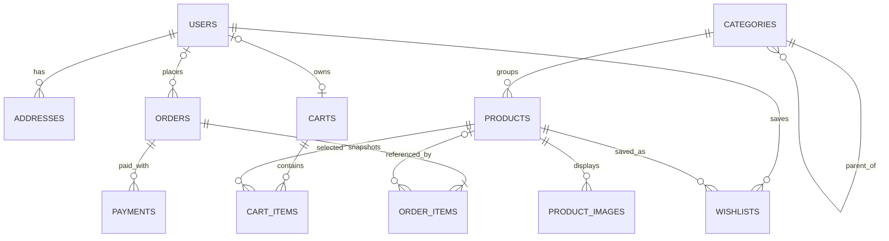

# Smart Cart foundation

This change keeps the current plain HTML/CSS/JavaScript storefront while establishing a consistent Node/Express runtime and a PostgreSQL schema foundation. Authentication, checkout and payment remain disabled until they have real secure implementations; the API returns an explicit `501` rather than claiming demo requests succeeded.

## Requirements

- Node.js 20 or later
- PostgreSQL 14 or later

## Run locally

1. Install dependencies: `npm install`
2. Create a PostgreSQL database named `smartcart_dev` (or use another database URL).
3. Copy `.env.example` to `.env` and update `DATABASE_URL` and TLS settings for your database.
4. Create tables: `npm run db:migrate`
5. Add sample catalog data: `npm run db:seed`
6. Start the app: `npm run dev` (or `npm start`)
7. Visit `http://localhost:3000/products.html`. `http://localhost:3000/healthz` is a JSON health check.

The server can start without a database to inspect the static storefront and health route. Database migration and seed commands require `DATABASE_URL` and an available PostgreSQL server.

## Current API behavior

- `GET /healthz` returns a minimal health response.
- `POST /login`, `POST /register`, `POST /api/auth/login`, and `POST /api/auth/register` return `501 Not Implemented` and do not accept or persist credentials yet.
- The existing login form calls the legacy endpoint; the signup form now calls the legacy endpoint and does not claim successful registration.
- Never enter real payment-card details into the existing demo checkout. It is not connected to a payment provider and is not an order system.

## Database schema and ER diagram

The first migration creates the durable entities required for the commerce core. Monetary amounts use `NUMERIC(12,2)` and currency codes are stored with the amount. Historical order lines and delivery addresses are snapshots so subsequent catalog/address edits do not rewrite prior orders.



`users` includes a role and email-verification timestamp. `addresses` belongs to a user. `products` belongs optionally to a category and has separate image rows. `carts` can belong to an account or a guest token and has quantity-constrained items. `orders` record totals, status and a shipping-address snapshot; `order_items` preserve price/name/SKU snapshots. `payments` record provider/status metadata only—not card details. `wishlists` provides the starting relation for saved products.

## Current folder structure

```text
api/index.js                 Vercel serverless API entry
migrations/                  Versioned PostgreSQL SQL migrations
public/                      Existing static storefront pages and assets
scripts/migrate.js           Transactional migration runner
scripts/seed.js              Idempotent starter catalog seed
src/app.js                   Shared Express app factory and safe base middleware
src/config/database.js       PostgreSQL connection pool
server.js                    Local Node server entry
 test/app.test.js             API smoke tests
```

The old root `index.js` remains as a compatibility entry and starts `server.js`. `api/index.js` exports the shared app for Vercel; Vercel's default static-file behavior serves the `public/` content, so there is no catch-all rewrite.

## Tests and sample data

- Run API smoke tests with `npm test`.
- Tests cover health, unknown routes, and fail-closed legacy authentication endpoints.
- Run `npm run db:migrate` then `npm run db:seed` for eight products across Electronics, Clothing, Home & Garden, Sports and Books. Re-running the seed updates those catalog records safely.
- Manual test checklist for this foundation: static home/product page loads; static assets load; `/healthz` returns 200 JSON locally; login/register return 501 and never return success; unknown paths return JSON 404; migration and seed execute against a fresh database and can be repeated.

## Vercel deployment

1. Import the repository into Vercel and keep the project root at the repository root.
2. Add `DATABASE_URL` in Vercel Project Settings. For managed databases, set `DATABASE_SSL=true` only when required by that provider.
3. Run the migration from a trusted local/CI environment against the production database (`npm run db:migrate`). Run `npm run db:seed` only if you explicitly want the sample catalog in production.
4. Deploy. Static pages are served from `public/`; the Express serverless function is at `/api` (health endpoint `/api/healthz`).
5. Verify `/products.html` and `/api/healthz` after deployment.

For local or persistent Node hosting, use `npm start`, set `DATABASE_URL` and `PORT`, and ensure the provider's database is reachable. Do not expose production database credentials in frontend code or commit `.env`.

## Important next implementation phase

The schema and hosting foundation do **not** make this production-ready by themselves. Next implement account registration/login using password hashing and secure HTTP-only session cookies, email verification/reset flows, then server-authoritative catalog/cart/order APIs. Only after selecting and configuring a real PayHere merchant account should payment callbacks/signature validation be added. Never collect or store raw card numbers/CVV in this app.
